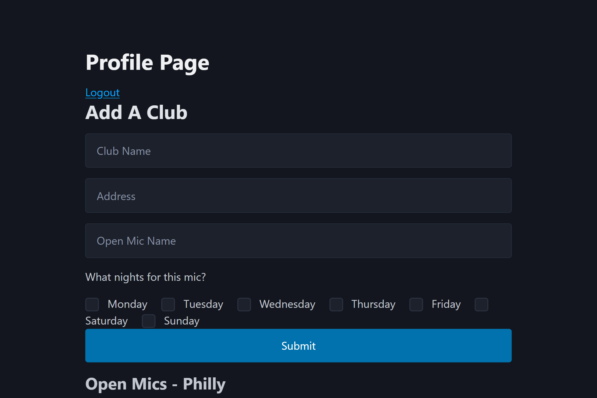

# OpenMic App

## Project Description

Open Mic is a Fullstack CRUD app that allows comics in Philly to find out what open mics are happening in the city and rate them.

### How It's Made:

* HTML & CSS – Structure and styling
* JavaScript – Front-end and back-end functionality
* Node.js – Server-side JavaScript
* Express.js – Routes and handling requests
* MongoDB – Storing user accounts and saved pins
* EJS – Displaying dynamic content
* Passport.js – User authentication

## Installation

1. Clone repo
2. run `npm install`

## Usage

1. run `npm run dev`
2. Navigate to `localhost:9000`

## Screenshots and Demo

### Application Interface

.png)

